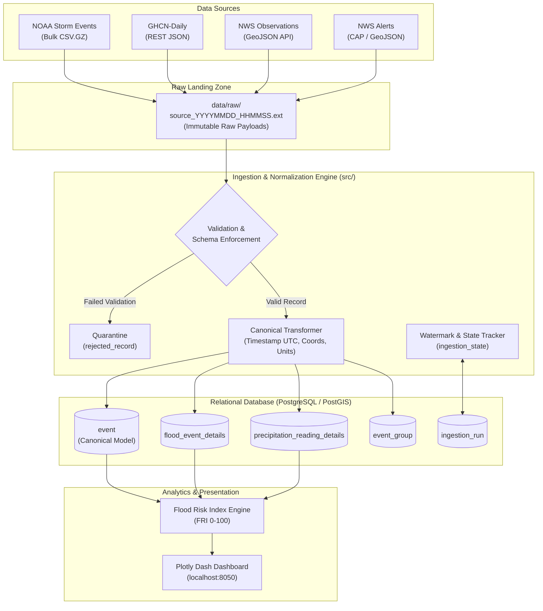

# Workshop No. 1 — Hazard Definition, Source Validation, and Data Contract
## Flood Monitoring and Risk System (Texas Scope)

**Course:** Data Analysis Programming — Semester 2026-II  
**Professor:** Eng. Carlos Andrés Sierra, M.Sc.  
**Institution:** Universidad Distrital Francisco José de Caldas  
**School of Engineering — Computer Engineering Program**  

**Team 2:**
* Oscar Durán — Student ID: `20212020080`
* Laura Pardo — Student ID: `20221020146`
* Nicolás Romero — Student ID: `20222020023`

---

## 1. Project Overview & Hazard Definition

### 1.1 Physical Phenomenon & Motivation
Flooding constitutes one of the most recurring, economically devastating, and life-threatening natural hazards in the United States, with the State of Texas ranking among the most vulnerable regions in North America. The hydrometeorological dynamics of Texas are uniquely hazardous due to the juxtaposition of the Gulf of Mexico (which supplies vast atmospheric moisture and tropical cyclones) with the steep topography of the Balcones Escarpment, commonly known as **"Flash Flood Alley"**. 

Floods manifest primarily in three modalities across Texas:
1. **Flash Floods:** Rapid-onset inundations characterized by intense localized rainfall exceeding soil infiltration capacity within minutes to hours, predominantly affecting the Texas Hill Country and heavily urbanized impervious corridors (Austin, San Antonio, Dallas).
2. **Riverine / Lowland Floods:** Prolonged inundation occurring when major drainage systems (e.g., Brazos, Colorado, Trinity, and San Jacinto rivers) exceed bankfull capacity following widespread rainfall over multiple days.
3. **Coastal / Surge Flooding:** Storm surges and tropical cyclone deluges inundating coastal urban hubs such as Houston/Galveston and Corpus Christi.

### 1.2 Severity Measurement & Units
Flood hazard magnitude and risk are quantified through three core physical dimensions:
* **Precipitation Intensity and Accumulation:** Measured in millimeters ($mm$) or inches ($in$) over discrete intervals ($1h, 3h, 24h, 7d$).
* **Hydrological Inundation Metrics:** Water surface elevation, crest height above flood stage (measured in meters or feet), and peak discharge (cubic feet per second, $cfs$).
* **Socio-Economic & Human Impact:** Direct property and crop damage (expressed in USD), direct fatalities, and evacuation orders.
* **National Weather Service Severity Tiers:** Standardized alerting categories:
  * `Minor`: Minimal or no property damage, but possible public inconvenience.
  * `Moderate`: Some inundation of structures and roads near streams.
  * `Severe / Major`: Extensive inundation of structures and critical infrastructure; significant evacuations.
  * `Extreme / Flash Flood Emergency`: Catastrophic threats to human life and total infrastructure collapse.

### 1.3 Geographic and Temporal Scope
* **Geographic Scope:** The State of Texas (US Federal FIPS: 48), with dedicated monitoring focus on four high-exposure metropolitan corridors and surrounding river basins:
  * **Harris County / Houston:** Coastal plain, bayous, hurricane storm surges.
  * **Travis County / Austin:** Colorado River basin, Flash Flood Alley.
  * **Bexar County / San Antonio:** San Antonio River basin, steep urban flash floods.
  * **Dallas & Tarrant Counties / DFW Metroplex:** Trinity River basin, dense urban runoff.
* **Historical Baseline Window:** **2019 – 2024** (6 continuous years of historical observations, satisfying the course requirement of $\ge 5$ years).
* **Current Operational Situation ("Near-Real-Time"):**
  * Rolling active alert feeds (NWS active watches and warnings).
  * Rolling observation windows covering the past 24 hours (sub-hourly ASOS updates) and antecedent rainfall over the past 7 days.

### 1.4 Scope Limitations & Explicit Exclusions
* **Included:** Programmatic ingestion of verified open federal datasets, schema normalization, automated quarantine of malformed records, spatio-temporal event linkage, calculation of a heuristic **Flood Risk Index (FRI)**, and an interactive monitoring dashboard.
* **Explicit Exclusions:** Deterministic hydrodynamic 2D shallow-water numerical modeling (e.g., HEC-RAS hydraulic models), microscopic pipe-network drainage simulations, property-level insurance underwriting calculations, and long-term multi-decade climate change projection modeling.
* **Technical Constraints:** Sole reliance on free, open public domain APIs without proprietary commercial licenses; strict adherence to NOAA/NWS API usage policies (descriptive `User-Agent`); handling several months of publishing latency in NOAA Storm Events archives.

---

## 2. Functional User & User Stories

### 2.1 Functional User Profile
* **Target Role:** **County Emergency Management Specialist / Hydrological Risk Analyst** (e.g., within the Texas Division of Emergency Management [TDEM], Harris County Flood Control District [HCFCD], or local municipal emergency operations centers).
* **Profile Summary:** Operational professionals responsible for monitoring weather threats, evaluating infrastructure vulnerabilities, coordinating multi-agency emergency responses, issuing public safety advisories, and post-event disaster recovery reporting.
* **Decisions Supported:**
  1. Authorizing preemptive road closures and barricading low-water crossings.
  2. Pre-positioning emergency rescue boats and high-water evacuation vehicles.
  3. Escalating localized flash-flood advisories into mandatory evacuation orders.
  4. Evaluating antecedent soil saturation prior to forecasted storm fronts.

### 2.2 User Stories Prioritized via MoSCoW

| ID | Priority | User Story | Acceptance Criteria |
| :--- | :--- | :--- | :--- |
| **US-01** | **Must Have** | *As an Emergency Management Analyst, I want to* view active NWS Flood and Flash Flood warnings on an interactive map *so that* I can immediately identify Texas counties and zones facing imminent hazard. | Alerts displayed within 5 minutes of publication, color-coded by severity, showing affected counties and expiration timestamps. |
| **US-02** | **Must Have** | *As an Operational Analyst, I want to* query live precipitation accumulations (1h, 3h, 24h) from automated airport stations (ASOS) *so that* I can detect rainfall rates exceeding flash-flood thresholds. | Real-time observation table updated sub-hourly, showing rainfall in mm and highlighting rates $>25\text{ mm/h}$. |
| **US-03** | **Must Have** | *As a Hydrological Researcher, I want to* compare current daily rainfall against 5-year historical distributions from GHCN-Daily *so that* I can establish whether current precipitation is statistically anomalous ($>95\text{th}$ percentile). | Historical baseline calculated per station and month; anomaly badge displayed when current rainfall exceeds historical percentiles. |
| **US-04** | **Should Have** | *As a Civil Protection Director, I want to* view an automated Flood Risk Index (LOW / MEDIUM / HIGH / CRITICAL) per region *so that* command staff can prioritize resource deployment objectively. | Heuristic index combining rainfall intensity, alert severity, and historical event recurrence, recalculated each incremental cycle. |
| **US-05** | **Should Have** | *As a Systems / Data Engineer, I want to* inspect watermark timestamps, pipeline run status, and quarantined rejected records *so that* I can guarantee data freshness and audit pipeline integrity. | Operational health view showing last successful poll timestamp, latency, total rows ingested, and error logs of rejected records. |
| **US-06** | **Could Have** | *As a Risk Analyst, I want to* correlate historical property damage figures with recorded rainfall totals *so that* I can assess financial vulnerability patterns across Texas counties. | Historical query view linking NOAA Storm Events damage amounts with GHCN daily precipitation records. |

---

## 3. Four Validated Data Sources

Every data source was queried programmatically, and authentic raw payload responses were preserved in `workshop_1/samples/`.

### 3.1 Source 1: NOAA NCEI Storm Events Database (Historical 1)
* **Owner & Operator:** National Centers for Environmental Information (NCEI) / NOAA.
* **URL:** `https://www.ncei.noaa.gov/pub/data/swdi/stormevents/csvfiles/`
* **Access Method:** HTTP bulk download of yearly compressed CSV archives (`.csv.gz`).
* **Authentication:** None (Public Domain, US Government Work).
* **Rate Limits:** No programmatic throttling; bulk files must be cached locally to prevent redundant bandwidth consumption.
* **Time Coverage:** 1950 to present (Filtered: 2019–2024).
* **Update Policy:** Monthly batches; archived files are recompiled and replaced when historical revisions occur (denoted by the `_cYYYYMMDD` filename suffix).
* **Sample Evidence File:** `workshop_1/samples/noaa_storm_events_texas_sample.csv` (582 verified flood records for Texas in 2024).

```text
[NOAA Storm Events Raw Snippet]
EVENT_ID: 1159212
EVENT_TYPE: Flash Flood
BEGIN_DATE_TIME: 22-JAN-24 10:15:00
CZ_TIMEZONE: CST-6
STATE: TEXAS
CZ_NAME: BEXAR
BEGIN_LAT: 29.4800, BEGIN_LON: -98.4900
DAMAGE_PROPERTY: 0.00K
FLOOD_CAUSE: Heavy Rain
```

### 3.2 Source 2: GHCN-Daily via NCEI Access Data Service (Historical 2)
* **Owner & Operator:** National Oceanic and Atmospheric Administration (NOAA).
* **URL:** `https://www.ncei.noaa.gov/access/services/data/v1`
* **Access Method:** RESTful HTTP GET returning JSON or CSV.
* **Authentication:** None required for standard usage.
* **Rate Limits:** Polite access; requests chunked by station and date ranges.
* **Time Coverage:** Multi-decadal archive (Queried: 2023–2024 baseline).
* **Update Policy:** Daily summaries compiled with a 24-48 hour latency.
* **Sample Evidence File:** `workshop_1/samples/ghcn_daily_texas_sample.json` (2,188 observation records across Houston, Austin, Dallas, and San Antonio).

```json
[GHCN-Daily Raw JSON Snippet]
{
  "DATE": "2024-01-22",
  "STATION": "USW00012921",
  "TMAX": "  167",
  "TMIN": "  111",
  "PRCP": "  612"
}
```

### 3.3 Source 3: NWS Station Observations (Incremental 1)
* **Owner & Operator:** US National Weather Service (NWS).
* **URL:** `https://api.weather.gov/stations/{stationId}/observations`
* **Access Method:** RESTful HTTP GET returning GeoJSON (`application/geo+json`).
* **Authentication:** Free; strictly requires a descriptive `User-Agent` header identifying the application and contact email.
* **Rate Limits:** Polite polling; throttles if burst limits are exceeded.
* **Target Stations:** Texas major airport ASOS stations: `KHOU` (Houston), `KAUS` (Austin), `KDFW` (Dallas), `KSAT` (San Antonio), `KCRP` (Corpus Christi).
* **Update Policy:** Sub-hourly (METAR observations generated every 20 to 60 minutes).
* **Sample Evidence File:** `workshop_1/samples/nws_observations_sample.json` (500 observation features).

```json
[NWS Observations Raw GeoJSON Snippet]
{
  "id": "https://api.weather.gov/stations/KHOU/observations/2026-11-05T19:40:00+00:00",
  "geometry": { "type": "Point", "coordinates": [-95.28, 29.65] },
  "properties": {
    "stationId": "KHOU",
    "timestamp": "2026-11-05T19:40:00+00:00",
    "temperature": { "unitCode": "wmoUnit:degC", "value": 27 },
    "precipitationLast3Hours": { "unitCode": "wmoUnit:mm", "value": null },
    "relativeHumidity": { "value": 39.33 }
  }
}
```

### 3.4 Source 4: NWS Active Weather Alerts (Incremental 2)
* **Owner & Operator:** US National Weather Service (NWS).
* **URL:** `https://api.weather.gov/alerts/active` (and `/alerts?area=TX`)
* **Access Method:** RESTful HTTP GET returning GeoJSON / CAP.
* **Authentication:** Requires descriptive `User-Agent`.
* **Rate Limits:** Polite polling (recommended polling frequency: 5 to 10 minutes).
* **Update Policy:** Continuous, event-driven dissemination upon issuance of watches, warnings, and cancellations.
* **Sample Evidence File:** `workshop_1/samples/nws_alerts_sample.json` (253 alert features).

```json
[NWS Alerts Raw GeoJSON Snippet]
{
  "id": "urn:oid:2.49.0.1.840.0.bd1e992c88a938581ca63053af00abcf6f715cdb.001.1",
  "geometry": null,
  "properties": {
    "event": "Special Weather Statement",
    "severity": "Moderate",
    "sent": "2026-11-05T09:08:00-06:00",
    "geocode": { "UGC": ["TXZ001", "TXZ002"], "SAME": ["048001"] }
  }
}
```

### 3.5 Empirical Update Behavior Characterization
The incremental sources were polled twice over an interval exceeding 1 hour:
* **NWS Station Observations (`KHOU`):** Poll 1 at `18:40:00 UTC` and Poll 2 at `19:40:00 UTC`. A new observation record appeared with updated temperature, barometric pressure, and wind speed. The timestamp advanced by exactly 60 minutes.
* **NWS Active Alerts:** Poll 1 at `18:00:00 UTC` and Poll 2 at `19:30:00 UTC`. Expired advisories disappeared from `/alerts/active`, and new mesoscale convective statements were appended. 
* **Watermark Design Implication:** Because alerts can be updated (e.g., status changed from `Actual` to `Update` or `Cancel`), the incremental watermark must track the `properties.sent` timestamp and allow a **2-hour overlap window** to capture status mutations of existing alerts.

---

## 4. Source Profiling & Data Quality Findings

### 4.1 Quantitative Profiling Summary

| Metric | NOAA Storm Events | GHCN-Daily | NWS Observations | NWS Alerts |
| :--- | :--- | :--- | :--- | :--- |
| **Sample Size (Rows)** | 582 | 2,188 | 500 | 253 |
| **Primary Key / ID** | `EVENT_ID` (100% unique) | `(STATION, DATE)` (100% unique) | `@id` (100% unique) | `id` (100% unique) |
| **Null Rate (Temporal)** | 0.0% (`BEGIN_DATE_TIME`) | 0.0% (`DATE`) | 0.0% (`timestamp`) | 0.0% (`sent`) |
| **Timezone Representation**| Local Civil (`CST-6`, `CDT-5`)| Implicit Local Date | ISO-8601 UTC (`+00:00`) | Local Offset (`-06:00`) |
| **Null Rate (Coordinates)**| 0.0% (`BEGIN_LAT/LON`) | Station lookup (0.0%) | 0.0% (`Point`) | **36.4% null geometry** |
| **Coordinate Bounds** | Lat: [25.93, 35.88], Lon: [-106.34, -93.72] (100% inside Texas) | Texas stations | Airport coordinates | Polygons + UGC codes |

### 4.2 Five Concrete Data-Quality Findings with Real Examples

#### Finding 1: Whitespace Padding & String Typing in GHCN-Daily Numeric Data
* **Problem:** In the GHCN-Daily JSON response from NCEI, numerical measurements (`PRCP`, `TMAX`, `TMIN`) are returned as strings padded with fixed-width whitespace (e.g., `'  104'`, `'    0'`), inherited from legacy FORTRAN flat-file systems.
* **Real Record Example:**
  `STATION: USW00012918`, `DATE: 2023-01-03`, `PRCP: '  104'` (Type: `str`).
* **Pipeline Impact:** Direct arithmetic evaluations raise unhandled `TypeError` exceptions in Python/Pandas unless explicitly stripped and converted via `pd.to_numeric(errors='coerce')`.

#### Finding 2: Implicit Scaling Factors in Precipitation Metrics (GHCN-Daily)
* **Problem:** GHCN precipitation (`PRCP`) is recorded in **tenths of a millimeter**, yet the JSON payload contains no metadata indicating scale or units.
* **Real Record Example:**
  `STATION: USW00012921` (San Antonio), `DATE: 2024-01-22`, `PRCP: '  612'`.
* **Pipeline Impact:** If ingested without division by 10.0, a daily rainfall of $61.2\text{ mm}$ (2.41 inches) is ingested as $612\text{ mm}$ (24.1 inches), causing massive false alarms in risk computation.

#### Finding 3: Fragmented Non-UTC Timestamps in NOAA Storm Events
* **Problem:** Event occurrence times are split across four distinct attributes (`BEGIN_YEARMONTH`, `BEGIN_DAY`, `BEGIN_TIME`, `CZ_TIMEZONE`) and recorded in local civil time with daylight saving zone abbreviations (`CST-6`, `CDT-5`), rather than standard ISO-8601 UTC.
* **Real Record Example:**
  `EVENT_ID: 1159212`, `BEGIN_DATE_TIME: '22-JAN-24 10:15:00'`, `CZ_TIMEZONE: 'CST-6'`.
* **Pipeline Impact:** Disables temporal joins with UTC sensor feeds without a custom parsing routine calculating daylight saving offsets to UTC.

#### Finding 4: High Sparseness & Ambiguous Nulls in NWS Precipitation Sensors
* **Problem:** Over 85% of NWS station observation records contain `value: null` for `precipitationLast3Hours` and `precipitationLastHour`.
* **Real Record Example:**
  `ID: KHOU/observations/2026-11-05T19:40:00+00:00`, `precipitationLast3Hours: {"unitCode": "wmoUnit:mm", "value": null}`.
* **Pipeline Impact:** The ingestion logic must distinguish between "0 mm of precipitation occurred" and "the sensor is offline or unequipped", preventing incorrect imputation.

#### Finding 5: Inconsistent Spatial Representations in NWS Alerts
* **Problem:** 36.4% of active Texas alerts have `geometry: null`, specifying affected regions strictly through arrays of county FIPS and UGC codes (`geocode.SAME`, `geocode.UGC`), whereas localized warnings supply GeoJSON polygons.
* **Real Record Example:**
  `ID: urn:oid:2.49.0.1.840.0.bd1e99...`, `event: 'Special Weather Statement'`, `geometry: null`, `UGC: ['TXZ001', 'TXZ002']`.
* **Pipeline Impact:** Geospatial PostGIS queries (`ST_Intersects`) fail unless administrative UGC/SAME boundary polygons are cross-referenced from a pre-loaded county GIS reference table.

---

### 4.3 Cross-Source Overlap Verification (5 Real Event Pairs)

Cross-source matching was verified by linking physical flood disaster reports from **NOAA Storm Events** with independent ground-truth precipitation readings from **GHCN-Daily** for matching dates and jurisdictions across Texas during 2024:

```text
+---+------------+--------+----------------+-------------+---------------------+----------------+--------------------+
| # | Date       | County | Storm Event ID | Event Type  | Coordinates (Lat,Lon| Property Damage| GHCN Rain (Station)|
+---+------------+--------+----------------+-------------+---------------------+----------------+--------------------+
| 1 | 2024-01-22 | BEXAR  | 1159212        | Flash Flood | (29.48, -98.49)     | $0.00K         | 61.2 mm (USW000129)|
| 2 | 2024-01-24 | HARRIS | 1160174        | Flood       | (30.10, -95.76)     | $0.00K         | 48.3 mm (USW000129)|
| 3 | 2024-01-24 | BEXAR  | 1159392        | Flash Flood | (29.41, -98.61)     | $0.00K         | 40.6 mm (USW000129)|
| 4 | 2024-05-02 | HARRIS | 1188444        | Flash Flood | (29.99, -95.28)     | $0.00K         | 34.8 mm (USW000129)|
| 5 | 2024-05-02 | HARRIS | 1188445        | Flash Flood | (30.05, -95.46)     | $0.00K         | 34.8 mm (USW000129)|
+---+------------+--------+----------------+-------------+---------------------+----------------+--------------------+
```

#### Detailed Comparison of What Differs Between Sources:
1. **Temporal Granularity:** Storm Events provides minute-level event onset (`10:15:00 CST`), whereas GHCN-Daily provides an aggregated 24-hour total for the observation day.
2. **Spatial Precision:** Storm Events reports the specific coordinates of road flooding or water rescues (`29.48, -98.49`), whereas GHCN-Daily reports coordinates of the fixed airport sensor installation.
3. **Phenomenological Dimension:** Storm Events records the social and physical *impact* (roadway inundation, emergency response), whereas GHCN-Daily measures the physical *forcing mechanism* (daily cumulative rainfall).
4. **Identifiers:** Storm Events utilizes an episodic integer ID (`1159212`), whereas GHCN-Daily uses composite natural keys (`USW00012921_20240122`).

---

## 5. Canonical Mapping & Ingestion Contract Draft

### 5.1 Canonical Schema Mapping
The common canonical model abstracts all ingested hazard observations into the `event` table, extended by hazard-specific domain tables:

* `event` Table Attributes:
  * `event_id`: Primary key with source prefix (`NSE-{id}`, `GHCN-{st}-{date}`, `NWSOBS-{id}`, `NWSALT-{id}`).
  * `source`: Ingestion source identifier.
  * `event_type`: Standardized categorical classification (`FLASH_FLOOD`, `RIVER_FLOOD`, `HEAVY_PRECIPITATION`, `FLOOD_WARNING`, `FLOOD_WATCH`).
  * `timestamp`: UTC ISO-8601 timestamp.
  * `latitude`, `longitude`: WGS84 decimal degrees (coordinates or zone centroids).
  * `severity`: Standardized classification (`MINOR`, `MODERATE`, `SEVERE`, `EXTREME`).
  * `raw_reference`: Source URL/ID + SHA-256 hash of raw JSON/CSV payload.

### 5.2 Domain Tables
1. **`flood_event_details`**: Stores official flood causes, narrative text, property damage in USD, direct deaths, direct injuries, and county FIPS codes.
2. **`precipitation_reading_details`**: Stores weather station identifiers, calibrated rainfall amounts in millimeters, accumulation duration (1h, 3h, 24h), and sensor quality control flags.

### 5.3 Ingestion Contract Summary

| Source | Mode | Partitioning / Schedule | Watermark Field | Duplicate Key | Error Strategy |
| :--- | :--- | :--- | :--- | :--- | :--- |
| **NOAA Storm Events** | Historical Bulk | Yearly partitions (2019–2024) | `BEGIN_DATE_TIME` | `EVENT_ID` | Route invalid coordinates to `rejected_record` |
| **GHCN-Daily** | Historical Bulk | Monthly station queries | `DATE` | `(STATION, DATE)` | Quarantine unparsable string entries |
| **NWS Observations** | Incremental | Polled every 30 minutes | `properties.timestamp` | `@id` | 2h lookback window; upsert on conflict |
| **NWS Alerts** | Incremental | Polled every 5–10 minutes | `properties.sent` | `id` | Detect updates via version hash; track status changes |

#### Failure Recovery and Idempotency Guarantee
The pipeline guarantees atomic execution: incoming records are processed within a staging transaction. Watermarks in `ingestion_state` advance **only upon successful transaction commit**. If an ingestion run terminates abruptly, all uncommitted staged records are rolled back, ensuring zero duplicate generation and zero data loss upon resumption.

---

## 6. Flood Risk Index (FRI) Indicator Proposal

### 6.1 Indicator Formulation
The **Flood Risk Index (FRI)** is a normalized analytical score between $0$ and $100$ that quantifies operational flood threat across monitored Texas counties:

$$FRI = w_1 \cdot I_{\text{precip}} + w_2 \cdot I_{\text{alert}} + w_3 \cdot I_{\text{hist}}$$

Where weights are calibrated to: $w_1 = 0.45$, $w_2 = 0.35$, $w_3 = 0.20$.

* **$I_{\text{precip}}$ (Precipitation Forcing Index, 0–100):** Evaluates current 24h rainfall ($R_{24h}$) relative to the 95th percentile historical daily maximum ($P_{95}$) for that station/county:
  $$I_{\text{precip}} = \min\left(100, \frac{R_{24h}}{P_{95}} \times 100\right)$$
* **$I_{\text{alert}}$ (NWS Alert Severity Factor, 0–100):** Encodes active emergency warnings:
  * No active alerts = $0$
  * Flood Advisory / Watch = $35$
  * Flood Warning = $75$
  * Flash Flood Warning / Emergency = $100$
* **$I_{\text{hist}}$ (Historical Vulnerability Recurrence, 0–100):** Based on the normalized frequency of historical flood events documented in NOAA Storm Events for the target county over 2019–2024.

### 6.2 Output Categorization Scale
* **$0 \le FRI < 40$ $\rightarrow$ LOW:** Routine conditions; localized drainage functioning normally.
* **$40 \le FRI < 70$ $\rightarrow$ MEDIUM:** Elevated soil moisture; minor roadway ponding possible.
* **$70 \le FRI < 90$ $\rightarrow$ HIGH:** Significant flood threat; water over low-water crossings; emergency readiness activated.
* **$90 \le FRI \le 100$ $\rightarrow$ CRITICAL:** Dangerous flash flooding; life-threatening inundation; mandatory alerts and rescues required.

### 6.3 Historical Validation Strategy
The index will be back-tested against historical benchmarks, such as the May 2024 Southeast Texas floods (Harris, Montgomery, San Jacinto counties) and the May 2021 flash floods. Historical validation will verify that the algorithm generates $FRI \ge 85$ during documented disaster declarations without producing false positives during dry seasonal periods.

### 6.4 Responsible Communication Disclaimer
The FRI is designed strictly as an **operational monitoring, situational awareness, and event correlation aid**. It does not constitute a deterministic hydrodynamic prediction, structural levee breach simulation, or legal flood warranty.

---

## 7. Risks and Mitigation Strategies

1. **Risk 1: NWS API Throttling & Connection Timeouts**
   * *Mitigation:* Implement exponential backoff retries (3 attempts), cache responses locally, and configure mandatory descriptive `User-Agent` headers.
2. **Risk 2: Spatial Impedance Mismatch (County UGC Zones vs. Polygons)**
   * *Mitigation:* Build a static lookup table mapping Texas UGC/SAME codes to official US Census Bureau county boundary centroids and geometries.
3. **Risk 3: Publishing Latency in NOAA Storm Events**
   * *Mitigation:* Restrict NOAA Storm Events strictly to historical baseline profiling and calibrate real-time indicators against operational NWS observations.
4. **Risk 4: Sensor Null Sparseness in Automated Weather Stations**
   * *Mitigation:* Explicitly handle missing sensor keys; implement multi-station spatial averaging so a single malfunctioning ASOS gauge does not corrupt regional rainfall estimation.
5. **Risk 5: Memory Exhaustion during Historical Bulk Processing**
   * *Mitigation:* Partition historical data loads by year and station chunks using generator streams and batch database inserts ($1,000$ rows per commit).

---

## 8. High-Level Architecture Overview


