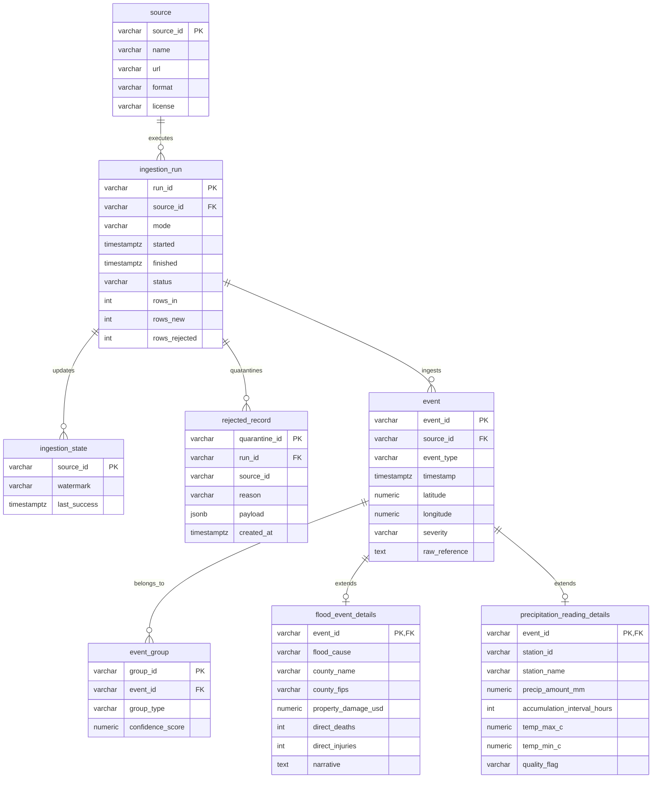

# Canonical Mapping and Ingestion Contract
**Project:** Flood Monitoring and Risk System (Texas Scope)  
**Team 2:** Oscar Durán, Laura Pardo, Nicolás Romero  
**Course:** Data Analysis Programming (Semester 2026-II)  
**Deliverable:** Workshop No. 1 — Canonical Mapping & Ingestion Contract Draft

---

## 1. Canonical Schema Mapping

The core system unifies heterogeneous observations into a canonical `event` abstraction. Below is the mapping from raw source fields to the canonical event model:

### Canonical `event` Model Attributes
* `event_id` (String / UUID): Unique surrogate identifier prefixed by source.
* `source` (String): Source identifier (`noaa_storm_events`, `ghcn_daily`, `nws_observations`, `nws_alerts`).
* `event_type` (String): Standardized phenomenon category (`FLASH_FLOOD`, `RIVER_FLOOD`, `HEAVY_PRECIPITATION`, `FLOOD_WARNING`, `FLOOD_WATCH`).
* `timestamp` (Timestamp with Timezone, UTC): Normalized occurrence or observation time.
* `latitude` (Float, WGS84): Geographic latitude coordinate in decimal degrees.
* `longitude` (Float, WGS84): Geographic longitude coordinate in decimal degrees.
* `severity` (String / Numeric): Standardized severity indicator (`MINOR`, `MODERATE`, `SEVERE`, `EXTREME`).
* `raw_reference` (String): Original source ID, URL, and cryptographic SHA-256 content hash.

### Source-to-Canonical Field Mapping Table

| Canonical Field | NOAA Storm Events | GHCN-Daily | NWS Station Observations | NWS Active Alerts |
| :--- | :--- | :--- | :--- | :--- |
| **`event_id`** | `'NSE-' || EVENT_ID` | `'GHCN-' || STATION || '-' || DATE` | `'NWSOBS-' || id` | `'NWSALT-' || id` |
| **`source`** | `'noaa_storm_events'` | `'ghcn_daily'` | `'nws_observations'` | `'nws_alerts'` |
| **`event_type`** | Map `EVENT_TYPE` (`Flash Flood` $\rightarrow$ `FLASH_FLOOD`, `Flood` $\rightarrow$ `RIVER_FLOOD`, `Heavy Rain` $\rightarrow$ `HEAVY_PRECIPITATION`) | When `PRCP >= 50 mm` $\rightarrow$ `HEAVY_PRECIPITATION`; else `DAILY_PRECIPITATION` | When `precipitationLast3Hours > 25 mm` $\rightarrow$ `HEAVY_PRECIPITATION`; else `SURFACE_OBSERVATION` | Map `event` (`Flash Flood Warning` $\rightarrow$ `FLASH_FLOOD_WARNING`, `Flood Watch` $\rightarrow$ `FLOOD_WATCH`) |
| **`timestamp`** | Parse `BEGIN_DATE_TIME` + `CZ_TIMEZONE` and convert to UTC ISO-8601 | Parse `DATE` as `YYYY-MM-DD 23:59:59 UTC` | `properties.timestamp` (UTC ISO-8601) | `properties.sent` (convert local offset to UTC) |
| **`latitude`** | `BEGIN_LAT` (or county centroid from `CZ_FIPS` if null) | Station coordinate lookup (`30.09` for KHOU, `30.19` for KAUS, etc.) | `geometry.coordinates[1]` | Centroid of `geometry` polygon, or County centroid from `geocode.SAME` |
| **`longitude`** | `BEGIN_LON` (or county centroid from `CZ_FIPS` if null) | Station coordinate lookup (`-95.76` for KHOU, `-97.67` for KAUS, etc.) | `geometry.coordinates[0]` | Centroid of `geometry` polygon, or County centroid from `geocode.SAME` |
| **`severity`** | Derived from `DAMAGE_PROPERTY` and `DEATHS_DIRECT` (`EXTREME` if damage > \$1M or deaths > 0; `SEVERE` if damage > \$50K; else `MODERATE`) | Derived from `PRCP_MM` (`EXTREME` $\ge 100\text{ mm}$, `SEVERE` $\ge 50\text{ mm}$, `MODERATE` $\ge 25\text{ mm}$, `MINOR` $< 25\text{ mm}$) | Derived from `precipitationLast3Hours` and `windSpeed` | Direct map from `properties.severity` (`Extreme`, `Severe`, `Moderate`, `Minor`) |
| **`raw_reference`** | `EVENT_ID` + SHA256 of row | `STATION || '_' || DATE` + SHA256 | `@id` + SHA256 of properties | `id` + SHA256 of alert payload |

---

## 2. Domain-Specific Tables

To prevent data loss of hazard-specific attributes, two domain tables extend the canonical `event` model via a foreign key relationship (`event_id`):

### Table: `flood_event_details`
Hazard-specific impacts and forensic details from official disaster records:
* `event_id` (FK to `event.event_id`, Primary Key)
* `flood_cause` (VARCHAR): Meteorological trigger (e.g., Heavy Rain, Dam Failure, Tropical Cyclone).
* `county_name` (VARCHAR): Administrative county (e.g., Harris, Bexar, Travis, Dallas).
* `county_fips` (VARCHAR): 5-digit US FIPS code (e.g., 48201 for Harris County).
* `property_damage_usd` (NUMERIC): Normalized monetary loss in US Dollars.
* `direct_deaths` (INTEGER): Number of direct fatalities.
* `direct_injuries` (INTEGER): Number of direct injuries.
* `narrative` (TEXT): Official meteorological summary of the flood episode.

### Table: `precipitation_reading_details`
Continuous hydrometeorological observations supporting risk calculation:
* `event_id` (FK to `event.event_id`, Primary Key)
* `station_id` (VARCHAR): Weather station identifier (e.g., USW00012918, KHOU).
* `station_name` (VARCHAR): Station name.
* `precip_amount_mm` (NUMERIC): Normalized rainfall in millimeters.
* `accumulation_interval_hours` (INTEGER): Time window (1h, 3h, 24h).
* `temp_max_c` (NUMERIC, Optional): Maximum daily temperature in Celsius.
* `temp_min_c` (NUMERIC, Optional): Minimum daily temperature in Celsius.
* `quality_flag` (VARCHAR): Data quality validation status (`PASSED`, `SUSPECT`, `ESTIMATED`).

---

## 3. Entity-Relationship (ER) Diagram

---

## 4. Ingestion Contract Draft

### Source 1: NOAA Storm Events (Historical)
* **Strategy:** Bulk load partitioned by year (2019 to 2024).
* **Pagination / Extraction:** Yearly compressed archives downloaded to `data/raw/`, filtered by `STATE == 'TEXAS'` and target event types.
* **Duplicate Key:** `EVENT_ID`.
* **Idempotency:** `ON CONFLICT (event_id) DO NOTHING`.
* **Watermark Field:** `BEGIN_DATE_TIME` (advances to latest event timestamp).

### Source 2: GHCN-Daily (Historical Baseline)
* **Strategy:** Monthly chunked REST queries per target station (`USW00012918`, `USW00013904`, `USW00023044`, `USW00012921`).
* **Duplicate Key:** `STATION` + `DATE`.
* **Idempotency:** `ON CONFLICT (station_id, observation_date) DO UPDATE`.
* **Watermark Field:** `DATE` (high-water mark).

### Source 3: NWS Station Observations (Incremental)
* **Strategy:** Watermark polling every 30 minutes for automated surface stations (`KHOU`, `KAUS`, `KDFW`, `KSAT`).
* **Overlap Window:** 2-hour sliding lookback window to catch late-arriving or corrected METAR observations.
* **Duplicate Key:** Station observation identifier `@id`.
* **Watermark Field:** `properties.timestamp`.

### Source 4: NWS Active Alerts (Incremental)
* **Strategy:** Event-driven polling every 5 to 10 minutes from `https://api.weather.gov/alerts/active?area=TX`.
* **Duplicate Key:** Unique alert identifier `id`.
* **State / Revision Detection:** Alerts transition through states (`Actual`, `Update`, `Cancel`). If an incoming record matches an existing `id` with higher sequence or later `sent` timestamp, the event record is updated and prior state retained in audit logs.
* **Watermark Field:** `properties.sent`.

### Failure Recovery & Halfway Run Guarantee
1. **Atomic Ingestion Transactions:** Ingestion runs process records in memory and stage them into a temporary table. Data is committed into canonical tables inside a single atomic database transaction.
2. **Quarantine Isolation:** Malformed records failing validation schemas are immediately routed to `rejected_record` with the offending payload and error reason, preventing pipeline aborts.
3. **Strict Watermark Advance:** The `ingestion_state.watermark` advances **only after** successful transaction commit of the batch. If a run crashes halfway, the database rolls back to the previous state and re-running resumes from the last committed watermark without data loss or duplicate rows.
